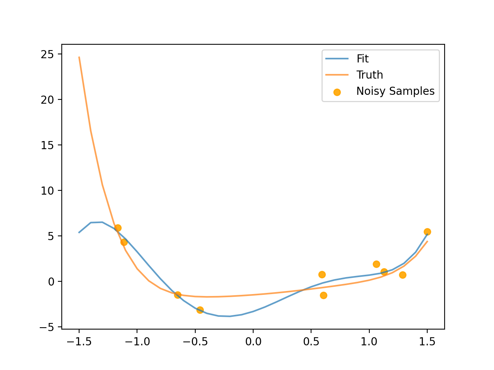

# Gauss-Newton

A Gauss-Newton algorithm written from scratch, using only numpy. It fits a model's parameters to a set of observations, computing the Jacobian with finite differences (forward, backward or central).

The example draws noisy samples from a random polynomial and fits a polynomial to them. In the plot, the fitted polynomial is blue, the true polynomial is orange and the noisy samples are dots.

<p align="center">
  
</p>

## Usage

```bash
pip install -r requirements.txt
python main.py
```

Using the optimizer with your own model:

```python
from gaussnewton import GaussNewton

gn = GaussNewton(error_fun, max_iteration=40, tolerance=1e-4, method="central")
param_opt = gn.fit(model, init_param, target, samples)  # model(param, samples) -> predictions
```

## Files

- `gaussnewton.py`: the `GaussNewton` optimizer
- `polynomial.py`: a simple polynomial model
- `main.py`: example that fits a polynomial to noisy samples and plots the result
