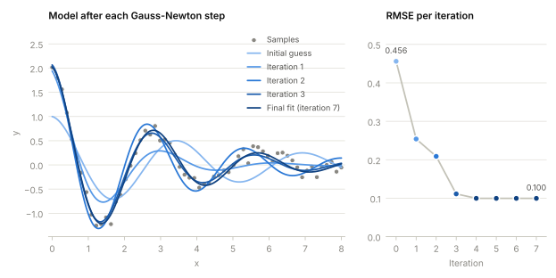

# Gauss-Newton

[](https://github.com/pbrandl/gauss_newton/actions/workflows/ci.yml)

A Gauss-Newton optimizer for nonlinear least-squares problems, written from scratch with NumPy as its only dependency. The Jacobian is approximated with forward, backward or central finite differences, so any model of the form `model(params, x)` can be fitted without providing derivatives.

<picture>
  <source media="(prefers-color-scheme: dark)" srcset="docs/convergence-dark.svg">
  
</picture>

<sub>Fitting <i>y = a·e<sup>−bx</sup>·cos(ωx)</i> to 60 noisy samples. Darker curves are later iterations; the error settles after four steps.</sub>

## Installation

```bash
git clone https://github.com/pbrandl/gauss_newton.git
cd gauss_newton
pip install .
```

## Usage

```python
import numpy as np
from gauss_newton import GaussNewton


def model(params, x):
    amplitude, rate, offset = params
    return amplitude * np.exp(-rate * x) + offset


x = np.linspace(0, 4, 40)
y = model([2.0, 1.5, 0.5], x) + np.random.default_rng(0).normal(0, 0.05, x.size)

result = GaussNewton(method="central").fit(model, x, y, initial_params=[1.0, 1.0, 0.0])
print(result.params, result.converged, result.n_iterations, result.error)
```

`GaussNewton` options:

| Argument         | Default     | Description                                                   |
| ---------------- | ----------- | ------------------------------------------------------------- |
| `error_fun`      | `rmse`      | Metric `error_fun(target, prediction)` used for convergence   |
| `max_iterations` | `100`       | Maximum number of Gauss-Newton steps                          |
| `tolerance`      | `1e-8`      | Stop when the error changes by at most this amount            |
| `method`         | `"central"` | Finite-difference scheme: `"forward"`, `"backward"`, `"central"` |
| `step`           | `1e-6`      | Finite-difference step width                                  |

`fit` returns a `FitResult` with the optimized `params`, a `converged` flag, `n_iterations`, the error `history`, the parameters after each step (`params_history`) and the final `error`. Progress is reported through the standard `logging` module under the `gauss_newton` logger.

## Examples

```bash
pip install ".[examples]"
python examples/damped_oscillation.py   # the figure above
python examples/polynomial_fit.py       # polynomial fit to noisy samples
```

Both scripts accept `--seed`, `--noise`, `--theme light|dark` and `--output FILE` to save the plot instead of showing it; run them with `--help` for all options.

## Development

```bash
pip install -e ".[dev]"
python -m pytest
ruff check . && ruff format --check .
python -m mypy
```

CI runs these checks on every push and pull request.
